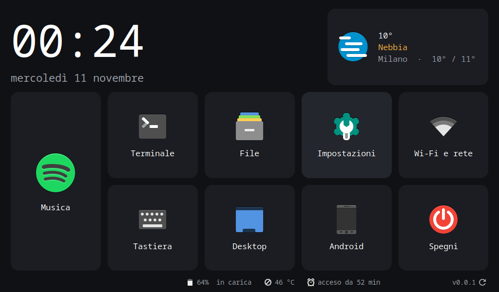

# obc40-home

A fullscreen, touch-friendly launcher for the **OBC40** board (HTE/Tecnint, NXP i.MX 8M Mini, 1024×600 display) running **Alpine Linux with XFCE**.



*Italiano: [vai alla sezione in italiano](#italiano).*

## Features

- Big clock and date, plus the weather from [Open-Meteo](https://open-meteo.com/) (no account needed). Tap the weather card to set your city.
- Large tiles for **Music** ([obc40-desk-player](https://github.com/dariotronic/obc40-desk-player)), Terminal, Files, Settings, Wi-Fi, on-screen keyboard, Desktop, **Android** and Power off. The Android tile only appears on dual-boot boards that have `boot-android`.
- Status bar with Wi-Fi network and signal, IP address, battery, temperature and uptime.
- `obc-fitwin`: maximises windows that would not fit the 600 px high screen.
- **Manual updates**: tap the version number at the bottom right to check for a new release.
- Built for touch: no tooltips, no dashed focus rings, and it works with the onboard on-screen keyboard.

## Requirements

- An OBC40 running Alpine Linux with an XFCE session for a normal user. A common setup has Android on the microSD, Alpine on the internal eMMC, and boot selection through the U-Boot environment.
- Python 3 with GTK 3: `apk add py3-gobject3 gtk+3.0`. Also recommended: `libwnck3` (for `obc-fitwin`), `papirus-icon-theme` and `onboard`.

Everything installs in your home directory: no root needed.

## Install

On the board, open a terminal **as the desktop user** (not root) and run **one line**:

```sh
wget -qO- https://raw.githubusercontent.com/dariotronic/obc40-home/main/get.sh | sh
```

To install the Spotify remote [obc40-desk-player](https://github.com/dariotronic/obc40-desk-player) too, in one go:

```sh
wget -qO- https://raw.githubusercontent.com/dariotronic/obc40-home/main/get.sh | sh -s -- --with-desk-player
```

[`get.sh`](get.sh) does the following:
1. checks the system packages and, if some are missing, offers to install them with `su` (it asks for the root password);
2. downloads the latest release and verifies its SHA-256 checksum;
3. runs `install.sh`;
4. starts the app.

Other options:
- `--no-autostart`: do not start the launcher at every login;
- `--desktop-icon` and `--autostart`: for Desk Player.

Running it again reinstalls the latest version.

<details><summary>Manual install, step by step</summary>

```sh
cd /tmp
wget https://github.com/dariotronic/obc40-home/releases/latest/download/obc40-home.tar.gz
wget https://github.com/dariotronic/obc40-home/releases/latest/download/obc40-home.tar.gz.sha256
sha256sum -c obc40-home.tar.gz.sha256
tar xzf obc40-home.tar.gz
sh obc40-home/install.sh            # add --no-autostart if you do not want it at every login
~/.local/bin/obc-home &
```
</details>

Optional, to make the XFCE desktop itself touch-friendly the way the author uses it (dark theme, bigger panels, Italian keyboard, docked on-screen keyboard): read [`extras/xfce-touch-setup.sh`](extras/xfce-touch-setup.sh), then run it from a downloaded package (`sh obc40-home/extras/xfce-touch-setup.sh`) or from the installed copy (`sh ~/.local/share/obc40-home/extras/xfce-touch-setup.sh`).

### Where things go

| Path | What |
|---|---|
| `~/.local/share/obc40-home/` | the app (`.prev` next to it is the previous version) |
| `~/.local/bin/obc-home`, `~/.local/bin/obc-fitwin` | launchers |
| `~/.config/autostart/obc-home.desktop`, `obc-fitwin.desktop` | start at login |
| `~/.config/obc-home.ini` | your settings (weather city) |

## Updating

Tap **`v0.0.1 ↻`** at the bottom right of the home screen. If a newer release exists you see what changed and can tap **Aggiorna** ("Update"). The app then:

1. downloads the release package;
2. verifies its SHA-256 checksum;
3. installs it, keeping the current version as `.prev`;
4. restarts.

If the new version fails to start within 20 seconds, the previous one is restored automatically. Nothing is ever updated without you tapping the button.

## Uninstall

```sh
rm -rf ~/.local/share/obc40-home ~/.local/share/obc40-home.prev ~/.local/bin/obc-home ~/.local/bin/obc-fitwin \
       ~/.local/share/applications/obc-home.desktop ~/.config/autostart/obc-home.desktop ~/.config/autostart/obc-fitwin.desktop
```

## Development

The code is plain Python 3 + GTK 3 with no build step.

| File | What |
|---|---|
| `obc-home` | the launcher |
| `obc-fitwin` | the window fitter |
| `obc_update.py` | the updater, shared with obc40-desk-player: keep the two copies identical |
| `faccessat-fix/` | `LD_PRELOAD` shim for the 4.14 kernel. Recent musl and GLib use `faccessat2`, which needs kernel 5.8 or newer. Build it with `zig cc -target aarch64-linux-musl -shared -fPIC -O2` |
| `dev/` | test helpers to run on the board: `env.sh` attaches an SSH shell to the graphical session, `shot.sh` takes a screenshot, `uitool.py` simulates taps |

To try a change on the board, copy the edited file over the installed one and restart the app:

```sh
scp obc-home <user>@<board>:.local/share/obc40-home/obc-home
ssh <user>@<board> '. ~/.local/share/obc40-home/dev/env.sh; pkill -f "share/obc40-home/obc-home"; setsid ~/.local/bin/obc-home >/dev/null 2>&1 &'
```

`dev/` is only in the git repository, not in the release package: copy it to the board if you need it.

### Releasing (maintainers)

1. Bump `VERSION` and add a `## x.y.z` section to `CHANGELOG.md`. That section becomes the release notes the user sees on the board.
2. Commit and push.
3. Run `python tools/build_release.py`. It builds `dist/obc40-home.tar.gz` and its `.sha256` from HEAD, then prints the `git tag` and `gh release create` commands to run.

The updater always takes the **latest release**: publish one only when it is ready for every board.

## Contributing

Issues and pull requests are welcome. Only the maintainers can push to this repository and publish releases.

## License

[MIT](LICENSE)

---

## Italiano

**obc40-home** è un launcher a schermo intero, pensato per il touch, per la scheda **OBC40** (HTE/Tecnint, display 1024×600) con **Alpine Linux e XFCE**.

**Cosa fa:**
- orologio, data e meteo (tocca il riquadro del meteo per scegliere la città);
- riquadri grandi per Musica, Terminale, File, Impostazioni, Wi-Fi, tastiera a schermo, Desktop, Android (solo sulle schede con dual boot) e Spegni;
- barra di stato con Wi-Fi, indirizzo IP, batteria, temperatura e tempo di accensione.

**Installazione**: sulla scheda apri un terminale **con l'utente del desktop** (non root) e scrivi **una riga**:

```sh
wget -qO- https://raw.githubusercontent.com/dariotronic/obc40-home/main/get.sh | sh
```

Per installare insieme anche Desk Player, il telecomando Spotify:

```sh
wget -qO- https://raw.githubusercontent.com/dariotronic/obc40-home/main/get.sh | sh -s -- --with-desk-player
```

Lo script controlla i pacchetti di sistema e, se ne manca qualcuno, si offre di installarli chiedendo la password di root. Poi scarica l'ultima versione, ne verifica il checksum, la installa e avvia l'app.

**Aggiornamenti**: tocca il numero di versione in basso a destra (**`v0.0.1 ↻`**). Se c'è una versione nuova vedi le novità e puoi toccare **Aggiorna**. L'app scarica il pacchetto, ne verifica il checksum, lo installa e si riavvia. Se la nuova versione non parte, torna da sola a quella precedente. Gli aggiornamenti partono solo quando tocchi il pulsante.

**Facoltativo**: `extras/xfce-touch-setup.sh` adatta tutto XFCE al touch, con tema scuro, pannelli più grandi, tastiera italiana e tastiera a schermo agganciata in basso. Leggilo prima di lanciarlo, perché modifica le impostazioni di XFCE.

**Per chi sviluppa**: vedi [Development](#development) e [Releasing](#releasing-maintainers). Le release le pubblicano solo i maintainer. Il changelog della versione è il testo che compare sulla scheda quando si aggiorna.
